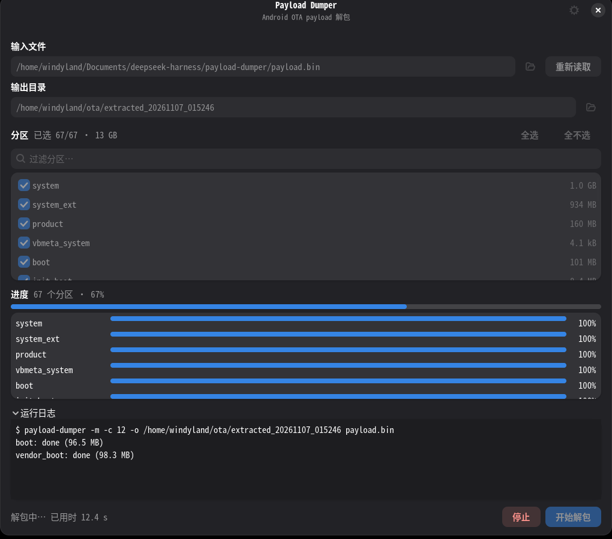

# payload-dumper GTK 前端

一个可选的 GTK4 / libadwaita 图形界面，用来包装
[`payload-dumper`](../README.md) 命令行工具。它不修改解包逻辑，只负责：

- 选择 `payload.bin` 或包含 `payload.bin` 的 OTA zip、选择输出目录；
- 调用 `-l -m` 读取分区，按分区勾选要解包的内容；
- 使用 `-m` 的 `分区:百分比` 输出驱动实时进度条；
- 汇总总体进度（按分区大小加权）、显示运行日志、停止任务；
- 提供 `-c`、`-old`、`-no-verify`、`-no-fec` 等选项；
- 完成后打开输出目录并显示总用时。



## 依赖

需要先按主仓库说明构建 CLI。图形界面额外依赖 PyGObject、GTK 4.10+
和 libadwaita 1.5+（使用了 `Gtk.FileDialog`、`Adw.ToolbarView` 和
`Adw.AlertDialog`）。Debian / Ubuntu：

```sh
sudo apt install python3-gi gir1.2-gtk-4.0 gir1.2-adw-1
```

## 启动

```sh
./ui/payload-dumper-gui
# 或
make gui
```

可执行文件查找顺序：

1. `PD_BIN` 环境变量；
2. `build/release/payload-dumper`；
3. `build/payload-dumper`；
4. `PATH` 中的 `payload-dumper`。

也可以在窗口右上角的设置（齿轮）中手动指定。找不到时会显示提示。

```sh
PD_BIN=/path/to/payload-dumper ./ui/payload-dumper-gui
```

## 使用

1. 选择输入文件；输入框旁可以打开文件选择器。
2. 点击“读取分区”查看分区列表；可全选、全不选或按名称过滤。
3. 设置输出目录；留空时在当前工作目录创建 `extracted_时间戳`。
4. 点击“开始解包”。失败时错误会显示在顶部横幅和状态栏，日志标签会标记为“运行日志（错误）”，展开即可查看详细输出。
5. 停止按钮发送 `SIGINT`，5 秒后仍未退出则发送 `SIGKILL`。

高级选项（齿轮图标）：

- **解包 worker 数**：对应 `-c`，0 表示自动（逻辑 CPU 数）；校验 worker
  数为一半，由 CLI 自行决定。
- **旧版镜像目录（-old）**：增量 OTA 需要。读取分区时若检测到增量分区，
  窗口会提示选择该目录。
- **跳过校验（-no-verify）**、**跳过 FEC（-no-fec）**：对应同名参数。
  `-no-fec` 生成的镜像不可刷写。
- **payload-dumper 可执行文件**：手动指定 CLI 路径。

界面会记住 worker 数、旧版镜像目录、校验开关和窗口大小，保存在
`~/.config/payload-dumper-gui/config.json`。

## 说明

- 进度条使用 `-m` 模式；该模式下 CLI 不输出常规头部和 `Elapsed time`
  摘要，因此总用时由界面用单调时钟测量。
- 只有选中部分分区时才传 `-p`；全选或不读取分区时解包全部分区。
- 分区列表中的“增量”标记来自普通 `-l` 输出中的 `delta` 标注。
- 界面不解析或校验镜像，所有解包、校验、FEC 逻辑仍在 CLI 中完成。
